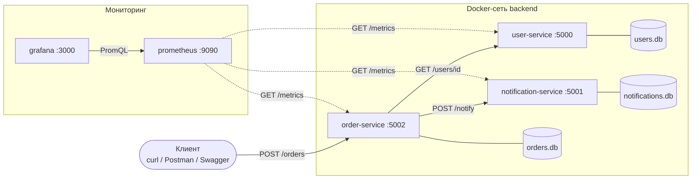
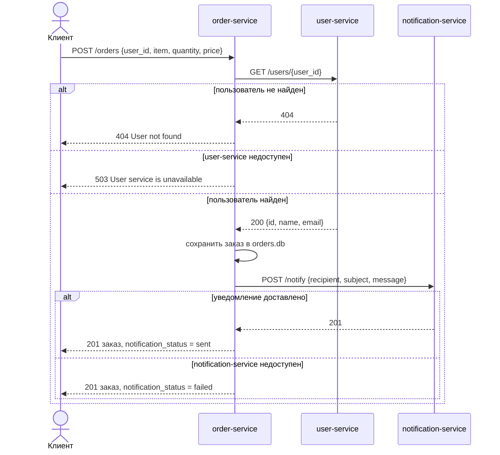

# Network-Centric Microservices

Учебное микросервисное приложение для практической работы № 13 «Разработка микросервисного приложения с использованием сетецентрической архитектуры». Система состоит из трёх независимых сервисов на **Python + FastAPI**, которые общаются **только по сети (HTTP/REST)**, имеют **собственные БД**, публикуют **метрики для Prometheus** (с дашбордом в Grafana) и запускаются **одной командой** через Docker Compose.

## Содержание

1. [Что делает приложение](#что-делает-приложение)
2. [Архитектура](#архитектура)
3. [Структура проекта](#структура-проекта)
4. [Быстрый старт](#быстрый-старт)
5. [Работа с API](#работа-с-api)
6. [Демонстрация отказоустойчивости](#демонстрация-отказоустойчивости)
7. [Мониторинг](#мониторинг)
8. [Автоматическая проверка](#автоматическая-проверка)
9. [Запуск без Docker](#запуск-без-docker)
10. [Конфигурация](#конфигурация)
11. [Реализованные принципы](#реализованные-принципы)
12. [Возможные проблемы](#возможные-проблемы)

## Что делает приложение

Интернет-магазин в миниатюре. Пользователь оформляет заказ через API; система проверяет, что такой пользователь существует, сохраняет заказ и отправляет уведомление на email пользователя.

| Сервис | Порт | Ответственность | Хранилище |
|---|---|---|---|
| **user-service** | 5000 | Регистрация и изменение данных пользователей | SQLite `users.db` |
| **notification-service** | 5001 | Отправка email-уведомлений (логирование и запись в БД) | SQLite `notifications.db` |
| **order-service** | 5002 | Создание и просмотр заказов, управление сценарием | SQLite `orders.db` |

Технологии: Python 3.12, FastAPI (REST), Uvicorn, SQLite, httpx, tenacity, Prometheus, Grafana, Docker, Docker Compose.

## Архитектура



### Сценарий создания заказа



Ключевые проектные решения:

- **Единственный путь взаимодействия — сеть.** Сервисы не используют общие файлы, БД и переменные; внутри Docker-сети обращаются друг к другу по именам (`http://user-service:5000`).
- **Критичная и некритичная зависимости.** Без User Service заказ создать нельзя (ответ `503`). Без Notification Service заказ создаётся, а в поле `notification_status` фиксируется `failed`.
- **Отказоустойчивость клиента.** Межсервисные вызовы используют таймауты, три попытки (`tenacity`) и circuit breaker (`order-service/resilience.py`).

## Структура проекта

```
network-centric-app/
├── user-service/
│   ├── app.py
│   ├── Dockerfile
│   └── requirements.txt
├── notification-service/
│   ├── app.py
│   ├── Dockerfile
│   └── requirements.txt
├── order-service/
│   ├── app.py            # REST API и бизнес-логика заказов
│   ├── clients.py        # HTTP-клиенты к соседним сервисам
│   ├── resilience.py     # circuit breaker и типы ошибок
│   ├── metrics.py        # бизнес-метрики Prometheus
│   ├── Dockerfile
│   └── requirements.txt
├── monitoring/
│   ├── prometheus.yml    # конфигурация сбора метрик
│   └── grafana/          # источник данных и готовый дашборд
├── scripts/
│   └── smoke_test.py     # сквозная проверка системы
├── docker-compose.yml
└── README.md
```

## Быстрый старт

Требуется установленный [Docker](https://docs.docker.com/get-docker/) с Docker Compose v2.

```bash
docker compose up --build -d
```

Команда соберёт три образа, скачает образы Prometheus и Grafana и запустит все контейнеры. `order-service` стартует после того, как оба соседних сервиса пройдут проверку `/health`. Система готова, когда в консоли появятся строки `Application startup complete` от всех сервисов.

Проверить состояние:

```bash
docker compose ps
curl http://localhost:5000/health
curl http://localhost:5001/health
curl http://localhost:5002/health
```

Остановка:

```bash
docker compose down        # остановить, данные сохранятся в volumes
docker compose down -v     # остановить и удалить данные
```

### Swagger UI

Каждый сервис публикует интерактивную документацию, в которой можно отправлять запросы прямо из браузера:

- http://localhost:5000/docs — User Service
- http://localhost:5001/docs — Notification Service
- http://localhost:5002/docs — Order Service

### Веб-интерфейсы мониторинга

- http://localhost:9090 — Prometheus (раздел Status → Targets показывает состояние сбора метрик)
- http://localhost:3000 — Grafana (логин `admin`, пароль `admin`), дашборд «Микросервисное приложение» загружается автоматически

## Работа с API

Примеры для Linux/macOS (bash). В Windows PowerShell используйте `curl.exe` и экранируйте кавычки либо работайте через Swagger UI или Postman.

### 1. Создать пользователя

```bash
curl -X POST http://localhost:5000/users \
  -H "Content-Type: application/json" \
  -d '{"name": "София Смирнова", "email": "anna@example.com"}'
```

```json
{"id": 1, "name": "София Смирнова", "email": "anna@example.com", "created_at": "2026-11-16T10:00:00+00:00"}
```

### 2. Создать заказ

```bash
curl -X POST http://localhost:5002/orders \
  -H "Content-Type: application/json" \
  -d '{"user_id": 1, "item": "Клавиатура", "quantity": 2, "price": 3500}'
```

```json
{
  "id": 1, "user_id": 1, "item": "Клавиатура", "quantity": 2, "price": 3500.0,
  "total": 7000.0, "status": "created", "notification_status": "sent",
  "created_at": "2026-11-16T10:01:00+00:00"
}
```

### 3. Убедиться, что уведомление отправлено

```bash
curl http://localhost:5001/notifications
docker compose logs notification-service
```

В логе появится строка вида:

```
notification-service | EMAIL #1 -> anna@example.com | Заказ №1 оформлен | София Смирнова, ваш заказ «Клавиатура» × 2 на сумму 7000.00 принят.
```

### 4. Заказ для несуществующего пользователя

```bash
curl -i -X POST http://localhost:5002/orders \
  -H "Content-Type: application/json" \
  -d '{"user_id": 999, "item": "Мышь", "price": 990}'
```

Ответ: `404 Not Found`, заказ не создаётся.

### Справочник эндпоинтов

**User Service (`:5000`)**

| Метод | Путь | Описание | Коды |
|---|---|---|---|
| POST | `/users` | Создать пользователя | 201, 409 (email занят), 422 |
| GET | `/users` | Список пользователей | 200 |
| GET | `/users/{id}` | Получить пользователя | 200, 404 |
| PUT | `/users/{id}` | Изменить имя и/или email | 200, 404, 409, 422 |
| DELETE | `/users/{id}` | Удалить пользователя | 204, 404 |
| GET | `/health` | Проверка состояния | 200 |

**Order Service (`:5002`)**

| Метод | Путь | Описание | Коды |
|---|---|---|---|
| POST | `/orders` | Создать заказ и отправить уведомление | 201, 404, 422, 503 |
| GET | `/orders` | Список заказов, фильтр `?user_id=` | 200 |
| GET | `/orders/{id}` | Получить заказ | 200, 404 |
| PATCH | `/orders/{id}/status` | Изменить статус заказа | 200, 404, 422 |
| DELETE | `/orders/{id}` | Удалить заказ | 204, 404 |
| GET | `/health` | Проверка состояния | 200 |

**Notification Service (`:5001`)**

| Метод | Путь | Описание | Коды |
|---|---|---|---|
| POST | `/notify` | Отправить уведомление (`recipient`, `subject`, `message`) | 201, 422 |
| GET | `/notifications` | Журнал уведомлений | 200 |
| GET | `/notifications/{id}` | Получить уведомление | 200, 404 |
| DELETE | `/notifications/{id}` | Удалить запись | 204, 404 |
| GET | `/health` | Проверка состояния | 200 |

## Демонстрация отказоустойчивости

Создайте пользователя (шаг 1 выше), затем выполните сценарии. Параллельно удобно держать открытым лог: `docker compose logs -f order-service`.

### Сценарий A. Недоступен notification-service

```bash
docker compose stop notification-service

curl -X POST http://localhost:5002/orders \
  -H "Content-Type: application/json" \
  -d '{"user_id": 1, "item": "Монитор", "quantity": 1, "price": 15000}'
```

Ожидаемый результат: `201 Created`, в ответе `"notification_status": "failed"`. В логе `order-service` видны повторные попытки и предупреждение о недоставленном уведомлении. Заказ при этом сохранён.

```bash
docker compose start notification-service
```

### Сценарий B. Недоступен user-service

```bash
docker compose stop user-service

curl -i -X POST http://localhost:5002/orders \
  -H "Content-Type: application/json" \
  -d '{"user_id": 1, "item": "Монитор", "quantity": 1, "price": 15000}'
```

Ожидаемый результат: `503 Service Unavailable` с телом `{"detail": "User service is unavailable"}`. Просмотр ранее созданных заказов продолжает работать:

```bash
curl http://localhost:5002/orders
```

После трёх подряд неудачных запросов circuit breaker размыкается и последующие вызовы отклоняются мгновенно, без ожидания таймаутов (в логе: `Circuit 'user-service' opened`). Через 10 секунд после запуска сервиса

```bash
docker compose start user-service
```

breaker пропускает пробный запрос и при успехе замыкается (`Circuit 'user-service' closed`) — система восстанавливается без перезапуска `order-service`.

## Мониторинг

Каждый сервис публикует метрики в формате Prometheus на эндпоинте `GET /metrics` (библиотеки `prometheus-fastapi-instrumentator` и `prometheus-client`). Prometheus опрашивает сервисы каждые 5 секунд, Grafana отображает данные на преднастроенном дашборде.

### Собираемые метрики

| Метрика | Сервис | Описание |
|---|---|---|
| `http_requests_total` | все | Число запросов по пути, методу и классу статуса (2xx, 4xx, 5xx) |
| `http_request_duration_highr_seconds` | все | Гистограмма времени обработки запросов |
| `users_created_total` | user-service | Число зарегистрированных пользователей |
| `notifications_sent_total` | notification-service | Число отправленных уведомлений |
| `orders_created_total` | order-service | Число созданных заказов с разбивкой по `notification_status` |
| `upstream_call_failures_total` | order-service | Число сбоев вызовов соседних сервисов |
| `circuit_breaker_open` | order-service | Состояние circuit breaker: 0 — замкнут, 1 — разомкнут |

Служебные эндпоинты `/health` и `/metrics` из статистики запросов исключены.

### Дашборд Grafana

Откройте http://localhost:3000 и перейдите в Dashboards → «Микросервисное приложение». Панели:

- доступность сервисов (UP/DOWN);
- режим работы circuit breaker (CLOSED/OPEN);
- частота запросов по каждому сервису;
- частота серверных ошибок (5xx);
- задержка обработки запросов (p95);
- количество сбоев межсервисных вызовов;
- распределение заказов по статусу уведомления;
- количество пользователей и отправленных уведомлений.

Для наглядной демонстрации создайте несколько заказов, затем остановите сервис (`docker compose stop user-service`), отправьте 4–5 запросов на создание заказа и наблюдайте, как на дашборде сервис получает статус DOWN, растёт число ошибок 5xx и размыкается circuit breaker. После `docker compose start user-service` показатели возвращаются в норму.

### Проверка метрик вручную

```bash
curl http://localhost:5002/metrics | grep -E "orders_created|circuit_breaker|upstream_call"
```

## Автоматическая проверка

При запущенной системе:

```bash
pip install httpx
python scripts/smoke_test.py
```

Скрипт создаёт пользователя, проверяет защиту от дубликатов, оформляет заказ, подтверждает доставку уведомления, корректную обработку несуществующего пользователя и доступность метрик Prometheus. Код возврата `0` означает, что все проверки пройдены.

## Запуск без Docker

Для отладки каждый сервис можно запустить отдельно (три терминала, Python 3.11+):

```bash
# терминал 1
cd user-service && pip install -r requirements.txt
uvicorn app:app --port 5000

# терминал 2
cd notification-service && pip install -r requirements.txt
uvicorn app:app --port 5001

# терминал 3
cd order-service && pip install -r requirements.txt
uvicorn app:app --port 5002
```

По умолчанию `order-service` обращается к `localhost:5000` и `localhost:5001`, файлы БД создаются в каталоге сервиса.

## Конфигурация

Параметры задаются переменными окружения (в `docker-compose.yml` уже настроены):

| Переменная | Сервис | Значение по умолчанию | Назначение |
|---|---|---|---|
| `DB_PATH` | все | `<имя>.db` | Путь к файлу SQLite |
| `USER_SERVICE_URL` | order-service | `http://localhost:5000` | Адрес User Service |
| `NOTIFICATION_SERVICE_URL` | order-service | `http://localhost:5001` | Адрес Notification Service |

Параметры устойчивости (таймаут 2 с, 3 попытки с паузой 0,3 с, порог breaker — 3 сбоя, время восстановления — 10 с) заданы в `order-service/clients.py` и `order-service/resilience.py`.

## Реализованные принципы

| Принцип | Как реализован |
|---|---|
| Сеть как среда взаимодействия | Межсервисные вызовы выполняются по HTTP, общие файлы и БД отсутствуют |
| Слабая связанность (loose coupling) | Сервисы используют только публичные контракты; Notification Service можно заменить независимо от остальных |
| Автономность данных | Каждый сервис использует собственную БД и отдельный volume |
| Service discovery | Docker DNS: поиск сервисов по именам (`user-service`, `notification-service`) |
| Statelessness | Сервисы не хранят состояние запросов в памяти; данные передаются в запросах и сохраняются в БД |
| Независимое развёртывание | Каждый сервис имеет отдельный Dockerfile и собственный процесс |
| Resilience | Таймауты, повторные попытки, circuit breaker, безопасная деградация и healthchecks |
| Наблюдаемость | Метрики Prometheus, общий дашборд Grafana и журналы событий |

## Возможные проблемы

- **Порт уже занят** — освободите порты 3000, 5000–5002, 9090 или измените левую часть проброса в `docker-compose.yml` (например, `"8000:5000"`).
- **macOS: порт 5000 занят AirPlay Receiver** — отключите его в «Системные настройки → Основные → AirDrop и Handoff» либо смените внешний порт `user-service`.
- **`order-service` не стартует** — он ждёт healthcheck соседей; проверьте `docker compose logs user-service notification-service`.
- **В Grafana нет данных** — в Prometheus (Status → Targets) все цели должны быть `UP`; сделайте несколько запросов к API и подождите 10–15 секунд.
- **Чистый старт с нуля** — `docker compose down -v && docker compose up --build`.
